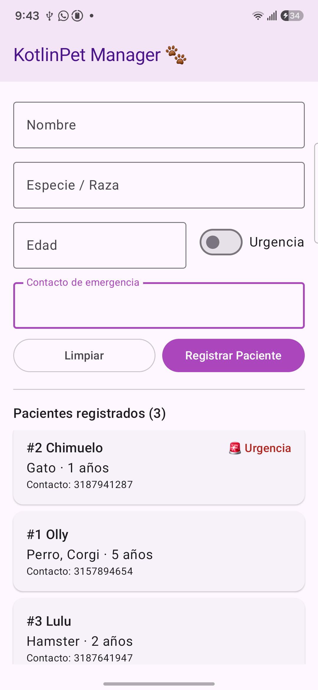
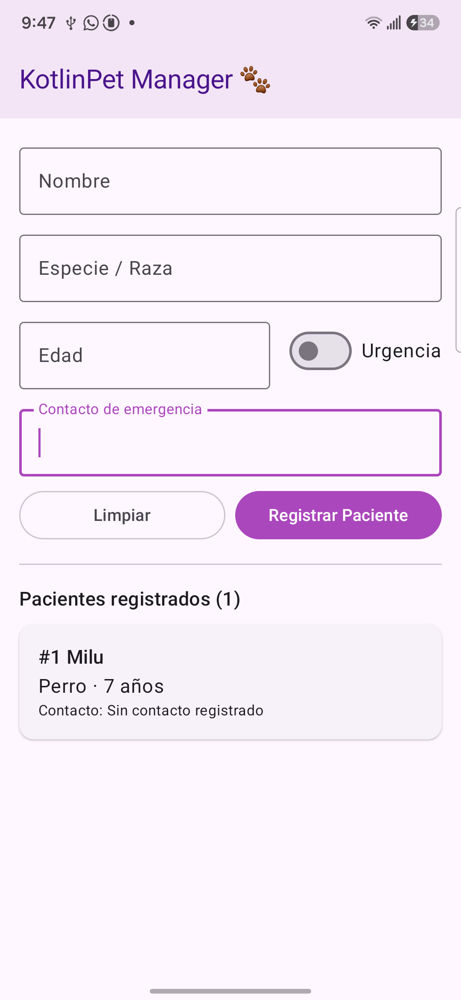

# KotlinPet Manager 🐾

**Ana María Agudelo** \
**Código:** 1114088975

## Descripción
Aplicación Android para registrar y visualizar los pacientes de una clínica veterinaria.
Permite ingresar el nombre, la especie o raza, la edad, un contacto de emergencia
e indicar si el paciente requiere atención urgente.

Desarrollada con Jetpack Compose, Material 3 y arquitectura MVVM.

## Capturas de pantalla del dispositivo en ejecución

| Lista de pacientes | Paciente sin contacto de emergencia |
|:---:|:---:|
|  |  |